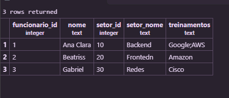
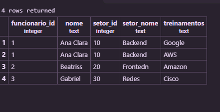
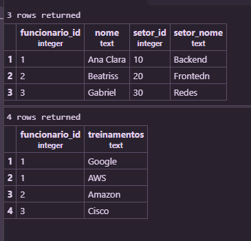

## Normalização de banco de dados

### 1FN
1FN -> 1 Forma Normal

1- Criamos a tabela:

```sql
 CREATE TABLE cadastro_original(
    funcionario_id INTEGER PRIMARY KEY,
    nome TEXT,
    setor_id INTEGER,
    setor_nome TEXT,
    treinamentos TEXT
);
```

2- inserimos os dados na tabela:

```sql
INSERT INTO cadastro_original VALUES
(1,'Ana Clara',10,'Backend','Google;AWS'),
(2,'Beatriss',20,'Frontend','Amazon'),
(3,'Gabriel',30,'Redes','Cisco');
```



3- Criamos uma cópia da primeira tabela aplicando a 1FN:

```sql
CREATE TABLE cadastro_1fn AS
SELECT funcionario_id,nome,setor_id,setor_nome, string_to_table(treinamentos, ';') AS treinamentos
FROM cadastro_original;

```

4- adiconando uma chave primária:

```sql
ALTER TABLE cadastro_1fn
ADD PRIMARY KEY (funcionario_id,treinamentos);
```


### 2FN
2FN -> 2 Forma Normal

1- separamos um tabela para funcionarios:

```sql
CREATE TABLE funcionarios AS
SELECT DISTINCT funcionario_id,nome,setor_id,setor_nome
FROM cadastro_1fn;

```
2- adicionamos uma PK:

```sql
ALTER TABLE funcionarios
ADD PRIMARY KEY (funcionario_id);
```


3- Criamos uma tabela de participações:

```sql
CREATE TABLE participacoes AS
SELECT funcionario_id,treinamentos
FROM cadastro_1fn;

ALTER TABLE participacoes
ADD PRIMARY KEY (funcionario_id,treinamentos);

```


4- adicionamos uma chave estrangeira:

```sql
ALTER TABLE participacoes
ADD FOREIGN KEY (funcionario_id) REFERENCES funcionarios(funcionario_id);
```

5- vizualização final das duas tabelas: 
```sql
SELECT * FROM funcionarios;
SELECT * FROM participacoes;
```
